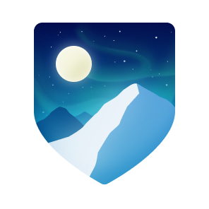

# Hi, I'm Fip 👋

Automation & API engineer — Python, bots & tooling.

## 🛠️ Stack

## 📊 Stats

## 🚀 Projects

Repo utamanya private, jadi badge-nya statis — isinya nyata, bukan tempelan.

**Bots & automation**

**Web & edge**

**Research & data**

**Infra**

## 🏅 Achievements

**Arctic Code Vault Contributor** — kode yang ikut diarsipkan GitHub Arctic World Archive, Svalbard (Arctic Code Vault, 2020).
**Quickdraw** — menutup issue/pull request dalam waktu kurang dari 5 menit setelah dibuka.

[Semua achievement →](https://github.com/fipsky?tab=achievements)

## 🐍 Contributions

<picture>
  <source media="(prefers-color-scheme: dark)" srcset="dist/snake-dark.svg" />
  
</picture>

## 🔭 Currently

- 🤖 Building resell automation (API clients + Telegram bots)
- 🔍 Into reverse engineering & API research
